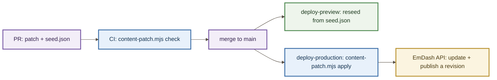

# Content patches

How a text change reaches the live site. Issue #662.

> [!TIP]
> **TL;DR** — edit the text through a patch file, never in the production admin. Write the file, then
> put the same change into `seed.json` and let CI and the production deploy do the rest:
>
> ```bash
> node scripts/content-patch.mjs seed seed/patches/2026-10-26-<slug>.json   # same change into seed.json
> node scripts/content-patch.mjs check                                      # what CI runs on every PR
> ```
>
> The production deploy applies pending patches on its own and refuses to overwrite a value that
> someone has changed in the admin.

## Why patches, not the seed

`seed/seed.json` creates a site the first time. EmDash does not let it change a live one:

> "Later edits to the seed file are not re-applied to that database … Existing data is never
> overwritten."
> — `vendor/emdash-skills/building-emdash-site/references/schema-and-seed.md`

The site went live on 2026-10-25, so its content lives in the production database. The admin could edit
that content directly, but an edit made there gets no PR, no copy gate and no record in the repository.
A patch keeps the PR, the gates and the history, and still writes through EmDash itself: every change
is an ordinary revision that the admin can revert.

We pay for this with a small script of our own, `scripts/content-patch.mjs`. EmDash supplies the parts
it is built from but does not ship this workflow.

## The convention

One file per change, named `YYYY-MM-DD-<slug>.json`. The date in the name sets the order in which patches
are applied. A file looks like this:

```json
{
	"date": "2026-10-26",
	"issue": 662,
	"summary": "What changes and why, in one sentence.",
	"changes": [
		{
			"collection": "layers",
			"slug": "cache",
			"locale": "es",
			"path": ["facts", { "key": "h2-2" }, "text"],
			"before": "The text the site holds today.",
			"after": "The text it will hold."
		}
	]
}
```

- **`path`** leads from the entry's data to one value. A segment is one of:
  - a field name;
  - an index into a list;
  - a one-key selector such as `{ "key": "h2-2" }`, which picks the single list item whose field
    matches. If the selector matches no item, or more than one, the patch fails.
- **`before`** is the value the patch expects to find. **`after`** is the value it writes. Both can be a
  string, a number or any JSON value.
- A patch is only for content that already exists. Collections and fields come from the seed's schema;
  entries come from the seed itself.

The same change also goes into `seed.json`. `content-patch.mjs seed <file>` writes each `after` into the
seed by replacing only that value's text, so the hand formatting elsewhere in the file survives. It
refuses to write if anything else would change.

## How a patch reaches production

Each node is a stage a change passes through, and each arrow is the order. Colour marks the role:
purple for our files and scripts, blue for what runs in CI, green for where readers see the change, and
amber for EmDash's database.



- **On every PR**, `content-patch.mjs check` validates every patch and confirms that `seed.json` already
  holds each `after`. A patch without its seed change fails CI.
- **The preview** reseeds from `seed.json` on every deploy, so it already shows the change.
- **The production deploy** runs `content-patch.mjs apply` after the worker is deployed. It reads each
  value first and only then decides what to do:

  | The site holds | What happens |
  | :--- | :--- |
  | the `after` | the change is already applied, so it is skipped. No ledger is kept: the content says what was applied |
  | the `before` | it is written with the entry's `_rev` (optimistic concurrency), published, then read back |
  | anything else | someone edited it outside the repository. The run **writes nothing** and fails, naming the value |

  It also refuses when an entry has an unpublished draft, because publishing would ship that draft
  too. After writing, it checks that every field the patch did not touch reads back unchanged.

## The token

The deploy authenticates with an EmDash API token held in the `production` environment's
`EMDASH_TOKEN` secret.

1. Create the token in the production admin, at `/_emdash/admin/settings/api-tokens`, with the scopes
   `content:read` and `content:write`.
2. Store it as the `EMDASH_TOKEN` secret of the `production` environment in GitHub.

Without the secret the deploy fails on this step with a message that says so. It never skips the step
silently.

## Running it by hand

```bash
node scripts/content-patch.mjs apply --url https://www.serverstartup.io --dry-run   # what would change
node scripts/content-patch.mjs apply --url http://localhost:8787 --dev-bypass       # a local dev server
```

`--dev-bypass` works only against a dev server (`astro dev`), through EmDash's development login. A
remote site needs `EMDASH_TOKEN` in the environment.

## Explanation: what was checked before this was trusted

Measured 2026-10-26 against a local dev server seeded from main's `seed.json`:

- The first patch wrote 14 values across 8 entries. Each entry gained a new published revision, with
  no draft left behind. A field-by-field diff of the entries before and after showed only those 14
  values changed.
- A second run wrote nothing and reported every change as already applied.
- After a value was edited through the API, the run refused and wrote nothing.
- The page rendered the new text and showed 50 facts, up from 46.

Not measured locally, because a dev server cannot purge the edge: whether publishing through the API
purges the production cache. The first production run checks it.
