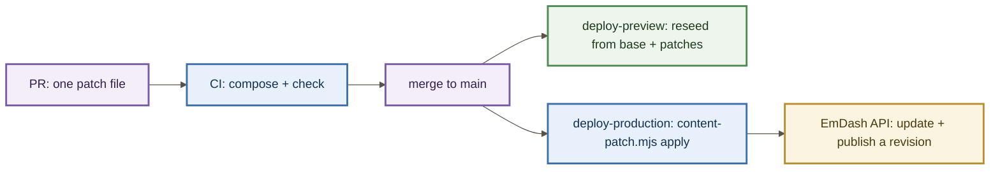

# Content patches

How a text change reaches the live site and every new environment. Issues #662 and #697.

> [!TIP]
> **TL;DR** — a text change is a patch file here and nothing else: never an edit to `seed/base.json`,
> never an edit in the production admin. Write the file, then compose and check:
>
> ```bash
> node scripts/content-patch.mjs compose   # seed/seed.json = seed/base.json + every patch
> node scripts/content-patch.mjs check     # what CI runs on every PR
> ```
>
> The production deploy applies pending patches on its own and refuses to overwrite a value that
> someone has changed in the admin.

## Why patches, not the seed

A seed creates a site the first time. EmDash does not let it change a live one:

> "Later edits to the seed file are not re-applied to that database … Existing data is never
> overwritten."
> — `vendor/emdash-skills/building-emdash-site/references/schema-and-seed.md`

The site went live on 2026-10-25, so its content lives in the production database. The admin could edit
that content directly, but an edit made there gets no PR, no copy gate and no record in the repository.
A patch keeps the PR, the gates and the history, and still writes through EmDash itself: every change
is an ordinary revision that the admin can revert.

We pay for this with a small script of our own, `scripts/content-patch.mjs`. EmDash supplies the parts
it is built from but does not ship this workflow.

## A frozen base plus deltas

Until #697 every patch was written twice: as a patch, and as the same change into `seed.json`. Two
branches changing the site's text both edited `seed.json`, often the same list, and collided in git
even when their patches were independent. The seed now works like a SAP Commerce initial load and
its delta impex:

| File | What it is |
| :--- | :--- |
| `seed/base.json` | The content at the freeze. It never changes: `tests/unit/content-patch.test.ts` pins its sha256 |
| `seed/patches/*.json` | One dated patch per change since. The only place text changes |
| `seed/seed.json` | The base plus every patch, written by `content-patch.mjs compose`. Generated and gitignored: never edit it |

Production applies the patches. A new environment (local dev, CI, the preview, a reseed) starts from
the base plus all of them. `npm run dev`, `npm test`, `scripts/ci-local-stack.sh` and
`scripts/preview.sh reseed` compose before they read, and so does the first step of every CI job.

`compose` decides each value exactly as the production deploy does (below), against the base instead
of the live site: a value the base already holds at its target is left alone, which is every patch
written before the freeze; one the base holds at an earlier state of its chain is written to the
target; anything else fails, naming the patch. It splices each value into the base's text one at a
time, in date order, so the base's formatting survives and two items created in one list land in
the order their patches were written.

What the freeze does not remove: two branches that create the same list item, or change the same
value from the same `before`. Each passes alone; after both merge, the chain is broken and `check`
fails naming both files. A rebase shows it on the PR before merging.

<!-- TODO(tech-debt): the next rebaseline moves settings.repoUrl and the site's repository links to serverstartup/www-serverstartup-io
Blocked: a patch cannot change a site setting, and EmDash's settings API drops repoUrl (src/api/schemas/settings.ts strips unknown keys).
The repository moved on 2026-11-06; GitHub redirects the old URLs until then. Move repoUrl and the links together, or
scripts/ci-check-cited-files.py stops recognising the links as citations. (origin: #704) -->
**Rebaselining** — folding the patches into a new base — is deliberate: one PR rewrites
`seed/base.json`, the pinned sha256 and the test's `IN_BASE` list of the patches the base already
holds, together. Creating or deleting an entry and changing the
schema also need one, because a patch cannot express them.

## The convention

One file per change, named `YYYY-MM-DD-<slug>.json`. The date in the name sets the order in which patches
are applied. A file looks like this:

```json
{
	"date": "2026-10-26",
	"issue": 662,
	"summary": "What changes and why, in one sentence.",
	"changes": [
		{
			"collection": "layers",
			"slug": "cache",
			"locale": "es",
			"path": ["facts", { "key": "h2-2" }, "text"],
			"before": "The text the site holds today.",
			"after": "The text it will hold."
		}
	]
}
```

- **`path`** leads from the entry's data to one value. A segment is one of:
  - a field name;
  - an index into a list;
  - a one-key selector such as `{ "key": "h2-2" }`, which picks the single list item whose field
    matches. If the selector matches no item, or more than one, the patch fails.
- **`before`** is the value the patch expects to find. **`after`** is the value it writes. Both can be a
  string, a number or any JSON value.
- One change per value in a patch. A patch, or two patches, cannot change a value and also its
  parent, such as `facts` and `facts[0].text`; `check` rejects it.
- A patch is only for content that already exists. Collections and fields come from the seed's schema;
  entries come from the seed itself. There are two exceptions: a new item in an entry's list, and a
  UI-label widget, both below.

### A new item in a list

A path that ends in a one-key selector, with `before: null`, adds an item that no item of the list
matches yet (#685):

```json
{
	"collection": "layers",
	"slug": "presentacion",
	"locale": "es",
	"path": ["facts", { "key": "h7-7" }],
	"before": null,
	"after": { "key": "h7-7", "text": "The new fact.", "status": "ok" }
}
```

- **`after`** is the whole item. It must be an object, and its selector field must hold the selector's
  value: here `"key": "h7-7"`. `check` rejects anything else.
- Applying the change appends the item at the end of the list. `content-patch.mjs compose` appends it in
  `seed/seed.json` the same way, indented like the item before it.
- An item that already matches the selector with other content is a conflict, and nothing is written.
- Create at most one item per list in a patch, for the same reason as widgets below.
- A later edit to that item changes the whole item, at the same path, with the created item as its
  `before`. Changing only `["facts", { "key": "h7-7" }, "text"]` would change a value and its parent
  across two patches, and `check` rejects that.

### UI labels: a change to a widget

UI labels live in the `ui_labels_es` and `ui_labels_en` widget areas, which are not a collection. A
change names the widget instead of an entry:

```json
{
	"widgetArea": "ui_labels_es",
	"widget": "consent",
	"path": ["content"],
	"before": null,
	"after": [{ "_type": "block", "style": "normal", "_key": "accept", "children": [{ "_type": "span", "text": "Aceptar" }] }]
}
```

- **`widget`** is the widget's title, the first argument of `labels.get()`.
- **`path`** is always `["content"]`. A widget change writes the widget's whole list of blocks, so a
  later change to one label repeats the list with that label changed.
- **`before: null`** means the widget does not exist yet. Applying the change creates it at the end of
  the area. In `seed/seed.json`, `content-patch.mjs compose` appends it to the area's `widgets`.
- A widget has no revisions and no `_rev`, so its write has no optimistic concurrency. The pre-flight
  read is the only guard: an admin edit made between that read and the write is overwritten. After
  writing, the run reads the widget back and checks its content and type.
- Create at most one new widget per area in a patch. The rule was made for a splice that inserted two
  at the same place in reverse order; `compose` now splices one value at a time, but `check` still
  enforces it.
- The edge cache is not proven to follow. EmDash's widget handlers invalidate the area's cache tag
  through Astro's route cache, but no widget write has been watched reaching Cloudflare's cache. Until
  one has, a page showing the label may serve the old text until the one-hour `maxAge` set in
  `src/middleware.ts` has passed, plus one request: the first request after the hour still gets the old
  copy and starts the refresh.

Nothing else changes for the change: the base stays as it is, and `compose` writes each `after` into
`seed/seed.json` by replacing only that value's text. It refuses to write if anything else would
change.

## How a patch reaches production

Each node is a stage a change passes through, and each arrow is the order. Colour marks the role:
purple for our files and scripts, blue for what runs in CI, green for where readers see the change, and
amber for EmDash's database.



- **On every PR**, `content-patch.mjs check` validates every patch and composes them over the base. A
  patch whose `before` the base and the patches before it never produce fails CI.
- **The preview** reseeds from the composed seed on every deploy, so it already shows the change.
- **The production deploy** runs `content-patch.mjs apply` after the worker is deployed. It reads each
  value first and only then decides what to do:

  Patches that change the same value form a **chain** in date order. If one patch changes A to B and a
  later one changes B to C, the value's **target** is C.

  | The site holds | What happens |
  | :--- | :--- |
  | the target | already applied, so it is skipped. No ledger is kept: the content says what was applied |
  | an earlier state of the chain (A or B above) | it is written to the target with the entry's `_rev` (optimistic concurrency), published, then read back |
  | anything else | someone edited **that value** outside the repository. The run **writes nothing** and fails, naming it |

  Before writing anything, the run reads every entry it will touch. Any conflict, or an entry with an
  unpublished draft, means it writes nothing at all. After writing an entry, it checks three things:
  the entry was published, the patched fields read back as written, and every other field is unchanged.

  The guarantee is per value, not per entry. An admin edit to a field that no patch touches goes
  unnoticed, and it is lost the next time someone rebuilds from the base and the patches. Hence the rule in
  `CONTRIBUTING.md`: do not edit text in the production admin.

  Writes across several entries are not atomic. If a write fails part-way (the network, or a `409` when
  someone saved the entry between the read and the write), the run stops with exit 3. It lists what it
  already wrote and published, and what it did not. A second run skips what was written and retries
  the rest.

## The token

The deploy authenticates with an EmDash API token held in the `production` environment's
`EMDASH_TOKEN` secret.

1. Create the token in the production admin, at `/_emdash/admin/settings/api-tokens`, with the scopes
   `content:read` and `content:write`.
2. Store it as the `EMDASH_TOKEN` secret of the `production` environment in GitHub.

Without the secret the deploy fails on this step with a message that says so. It never skips the step
silently.

## Running it by hand

```bash
node scripts/content-patch.mjs apply --url https://www.serverstartup.io --dry-run   # what would change
node scripts/content-patch.mjs apply --url http://localhost:8787 --dev-bypass       # a local dev server
```

`--dev-bypass` works only against a dev server (`astro dev`), through EmDash's development login. A
remote site needs `EMDASH_TOKEN` in the environment.

## Explanation: what was checked before this was trusted

Measured 2026-10-26 against a local dev server seeded from main's `seed.json`:

- The first patch wrote 14 values across 8 entries. Each entry gained a new published revision, with
  no draft left behind. A field-by-field diff of the entries before and after showed only those 14
  values changed.
- A second run wrote nothing and reported every change as already applied.
- After a value was edited through the API, the run refused and wrote nothing.
- With an unpublished draft on an entry, the run refused and wrote nothing.
- The page rendered the new text and showed 50 facts, up from 46.

Measured 2026-10-28 against a local dev server seeded from main's `seed.json`, for a new list item
(#685):

- The run wrote the two `presentacion` / `presentation` entries, appending fact `h7-7` to each, and
  reported every other field unchanged.
- A second run wrote nothing.
- After the created item's text was edited in the database, the run refused and wrote nothing.
- `/deconstruyendo` and `/en/deconstructing` rendered the new fact.

Not measured locally, because a dev server cannot purge the edge: whether publishing through the API
purges the production cache. The first production run checks it.
